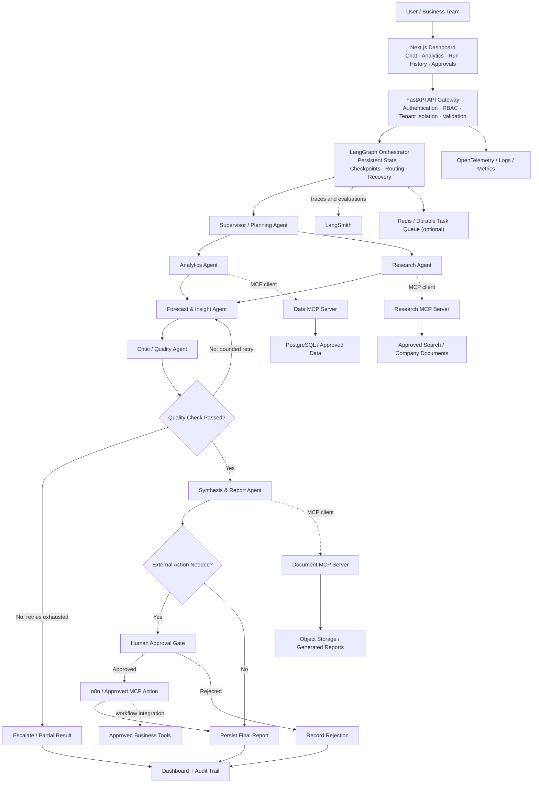
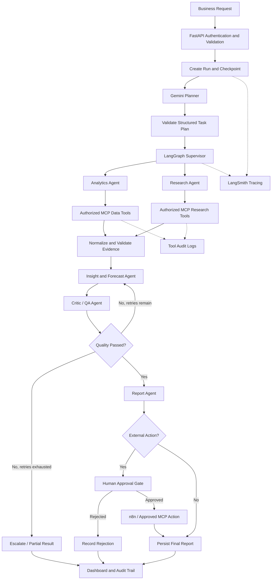

# Enterprise Multi-Agent AI System Using Gemini API + MCP

An advanced, enterprise-oriented AI operations and intelligence platform built with the **Gemini API**, **LangGraph**, **Model Context Protocol (MCP)**, **LangSmith**, and **n8n**.

The system accepts complex business requests, decomposes them into tasks, coordinates specialized agents, retrieves authorized data through MCP tools, validates evidence, generates reports, and routes consequential actions through human approval.

> **Project status:** This README describes the proposed architecture and implementation roadmap. Features must be implemented, configured, secured, and tested before the system is considered production-ready.

---

## 1. Project Overview

Imagine a company manager asks:

> “Analyze why our revenue dropped this quarter, compare product performance, investigate the likely causes, forecast next quarter, and prepare an evidence-backed report. Send it to the finance team after approval.”

The system can:

1. Break the request into dependent subtasks.
2. Analyze company data using authorized database tools.
3. Research relevant internal documents and approved external sources.
4. Identify trends and anomalies and forecast scenarios.
5. Verify calculations and citations before accepting results.
6. Generate a business report with recommendations and confidence indicators.
7. Request human approval before sending the report or triggering business actions.
8. Record agent decisions, tool calls, latency, failures, and cost.

**Core design principle:** Gemini provides reasoning and generation capabilities, LangGraph controls the multi-agent workflow, and MCP provides standardized access to tools and data.

## 2. Project Goals

- Coordinate specialized AI agents on complex business tasks.
- Use MCP as a standardized interface to tools and data sources.
- Use LangGraph for stateful orchestration and conditional routing.
- Use LangSmith for tracing, debugging, and evaluation.
- Use n8n to trigger external business workflows.
- Provide a dashboard for requests, execution status, reports, and approvals.
- Apply authentication, authorization, validation, and audit logging.
- Measure quality, latency, reliability, and cost.

---

## 3. Advanced System Architecture



### Responsibilities

- **Frontend:** Request submission, run status, reports, and human approvals.
- **FastAPI:** API endpoints, validation, authentication, authorization, and rate limiting.
- **LangGraph:** Agent coordination, shared workflow state, branching, retries, and checkpoints.
- **Gemini API:** Language-model inference, planning, reasoning, and structured generation.
- **MCP clients and servers:** Standardized discovery and invocation of approved tools and resources.
- **n8n:** Scheduled workflows and integrations such as email, Slack, or CRM tasks.
- **PostgreSQL:** Application data, users, projects, workflow metadata, and results.
- **Redis / background worker:** Optional caching and asynchronous task processing.
- **LangSmith and OpenTelemetry:** Tracing, evaluation, latency, and debugging.
- **Object storage:** Uploaded files and generated reports.

### Important architecture distinctions

- **Gemini API** provides model inference; it does not replace your workflow engine or database.
- **LangGraph** controls which agent runs next, what state it receives, and how failures or approvals are handled.
- **MCP** standardizes tool access; each MCP server must still enforce its own permissions.
- **n8n** handles integrations and external business workflows; it is not the primary reasoning engine.
- **LangSmith** supports tracing and evaluation; it is not a security boundary.
- **Policy enforcement** checks whether an agent is allowed to call a tool before execution.

---

## 4. Recommended Technology Stack

| Layer | Technology | Purpose |
|---|---|---|
| LLM | Gemini API via `google-genai` | Reasoning, summarization, structured responses |
| Orchestration | LangGraph | Stateful workflows, branching, retries, approvals |
| Agent tools | MCP Python SDK | Standardized access to custom and external tools |
| Backend | FastAPI + Pydantic | Secure APIs and schema validation |
| Frontend | Next.js + TypeScript | Enterprise dashboard |
| Workflow automation | n8n | CRM, email, Slack, scheduled operations |
| Primary database | PostgreSQL | Business data, users, tasks, audit metadata |
| Vector search | pgvector (optional) | Retrieval over company documents |
| Background jobs | Redis + Celery or an equivalent worker | Long-running jobs and asynchronous processing |
| Tracing | LangSmith + OpenTelemetry | Execution traces, debugging, latency analysis |
| Testing | pytest + agent evaluation datasets | Regression tests and quality measurement |
| Deployment | Docker + cloud infrastructure | Reproducible builds and deployment |
| Security | OAuth/OIDC + RBAC + policy checks | Authentication, permissions, controlled execution |

Use Google's official [Gen AI SDK for Python](https://googleapis.github.io/python-genai/) for Gemini API integration. For new projects, avoid starting with the legacy `google-generativeai` Python package.

Configure the Gemini model name using environment variables rather than hardcoding it throughout the codebase. Select a model based on current availability, quality tests, latency, and cost.

### Recommended initial deployment

Start with:

- Python
- FastAPI
- Gemini API via `google-genai`
- LangGraph
- MCP Python SDK
- PostgreSQL
- LangSmith
- Docker

Add Next.js and n8n as the product and workflow needs become clear. Kubernetes, Kafka, and a separate deployed service for every agent are not mandatory for the first implementation.

---

## 5. Multi-Agent Design

Use a **supervisor-and-specialists architecture**. The supervisor manages the workflow, while specialized agents handle focused jobs.

| Agent | Responsibility | Example output |
|---|---|---|
| Supervisor / Planner | Understands the request and creates a structured plan | Tasks, dependencies, permitted tools |
| Analytics Agent | Queries approved datasets and calculates metrics | Revenue, growth, product rankings |
| Research Agent | Retrieves approved supporting context | Findings and source references |
| Forecast & Insight Agent | Interprets evidence and estimates scenarios | Findings, forecasts, assumptions |
| Critic / Quality Agent | Checks evidence, arithmetic, and completeness | Pass/fail decision and issues |
| Synthesis & Report Agent | Creates the final report | Markdown, HTML, or PDF report |

Agents should return structured outputs with explicit fields such as `status`, `findings`, `evidence`, `errors`, and `next_action`. Prefer compact result objects over passing large, unstructured conversation histories between agents.

### Agent responsibilities in detail

#### 1. Supervisor / Planner Agent
- Breaks a complex request into a task plan.
- Identifies dependencies and tasks that can run in parallel.
- Selects appropriate agents and permitted tools.
- Applies task limits and respects the system's authorization policies.

#### 2. Analytics Agent
- Queries approved data through MCP tools.
- Calculates KPIs and compares reporting periods.
- Detects anomalies and identifies data-quality issues.
- Returns the figures, definitions, and data provenance.

#### 3. Research Agent
- Searches approved company documents and external sources.
- Retrieves relevant evidence.
- Returns source identifiers, timestamps when available, and relevance assessments.

#### 4. Forecast & Insight Agent
- Combines validated business metrics with retrieved evidence.
- Uses statistical models for forecasting and scenario analysis.
- Separates measured facts from hypotheses and assumptions.

#### 5. Critic / Quality Agent
- Checks calculations, evidence, schema validity, and completeness.
- Identifies unsupported claims or conflicting sources.
- Requests bounded retries or escalates unresolved issues.

#### 6. Synthesis & Report Agent
- Produces an evidence-backed report.
- Includes findings, assumptions, recommendations, limitations, and next actions.
- Cannot bypass tool permissions or approval requirements.

Use Python libraries for numerical calculations rather than relying on the language model to perform important arithmetic from memory.

---

## 6. How Gemini API and MCP Work Together

Gemini function calling allows a model to request a tool operation. Your application validates and executes that operation, then returns the result to the model. MCP provides a standardized way for your application to discover and invoke tools exposed by MCP servers. These mechanisms are related but distinct.

### Recommended execution flow

1. FastAPI receives and validates the business request.
2. LangGraph invokes the planner using Gemini.
3. The planner returns a validated task plan.
4. LangGraph routes tasks to the analytics and research agents.
5. Each agent uses an MCP client to discover permitted tools on the relevant MCP server.
6. The application validates permissions and arguments before executing a tool.
7. Results return as structured data with provenance where possible.
8. The insight and critic agents examine the evidence.
9. LangGraph routes the workflow to a retry, approval, or report node.
10. The application stores the outcome and exposes the run trace to authorized users.

**Security rule:** Never execute a privileged operation just because a model generated its tool name or arguments. Validate the requested tool against an allowlist and enforce authorization independently of the prompt.

### Example MCP servers and tools

| MCP server | Example tools | Purpose |
|---|---|---|
| Data MCP Server | `get_sales_summary`, `query_readonly_database`, `calculate_kpis` | Controlled business analytics |
| Research MCP Server | `search_approved_sources`, `search_company_docs` | Evidence retrieval |
| Document MCP Server | `read_document`, `create_report`, `save_report` | Document processing |
| Automation MCP Server | `send_approved_email`, `notify_slack`, `create_crm_task` | Approved business actions |

MCP supports tools, resources, and prompts. For example, a data server can expose database schema information as a resource, and reusable analysis instructions can be exposed as prompts.

### MCP and n8n

n8n can provide workflow automation and external integrations. Depending on the n8n version and deployment, its MCP Client Tool node can connect an AI workflow to external MCP tools, and its MCP Server Trigger can expose selected workflow functionality to external MCP clients. Confirm the relevant node behavior in the version you deploy.

---

## 7. Advanced Workflow



### Reliability controls

- Persistent workflow state and recovery after interruption.
- Parallel execution for independent tasks.
- Explicit dependencies between tasks.
- Typed agent outputs with validation.
- Bounded retries and failure escalation.
- Evidence provenance and reproducible calculations.
- Human approval before consequential actions.
- Per-user and per-tenant permissions.
- End-to-end tracing and evaluation.
- Cost, latency, and execution budgets.

Avoid unrestricted agent loops. Set maximum iterations, execution deadlines, tool-call budgets, and model-token limits for each run.

---

## 8. Suggested GitHub Repository Structure

```text
enterprise-gemini-multi-agent/
├── frontend/
│   ├── app/
│   ├── components/
│   └── lib/
├── backend/
│   ├── main.py
│   ├── api/
│   │   ├── routes.py
│   │   ├── auth.py
│   │   └── approvals.py
│   ├── agents/
│   │   ├── planner.py
│   │   ├── analytics.py
│   │   ├── researcher.py
│   │   ├── forecaster.py
│   │   ├── critic.py
│   │   └── reporter.py
│   ├── graph/
│   │   ├── state.py
│   │   ├── workflow.py
│   │   ├── routing.py
│   │   └── checkpoints.py
│   ├── llm/
│   │   ├── gemini_client.py
│   │   └── model_config.py
│   ├── mcp/
│   │   ├── clients.py
│   │   ├── permissions.py
│   │   └── servers/
│   │       ├── data_server.py
│   │       ├── research_server.py
│   │       └── document_server.py
│   ├── policy/
│   ├── database/
│   ├── services/
│   └── evaluation/
├── n8n/
│   └── workflows/
├── tests/
│   ├── unit/
│   ├── integration/
│   ├── security/
│   └── evaluations/
├── infra/
│   ├── docker/
│   └── deployment/
├── docker-compose.yml
├── .env.example
├── requirements.txt
└── README.md
```

This is a logical starting structure. Initially, run the backend and a small number of MCP servers locally or in a controlled deployment. Split services into separate deployments when isolation, scaling, or operational needs justify it.

---

## 9. Advanced Development Roadmap

### Phase 1 — Gemini foundation
- Set up the Google Gen AI SDK.
- Configure the model through environment variables.
- Create the FastAPI application and Pydantic schemas.
- Implement error handling and unit tests.

**Deliverable:** A working Gemini-backed API with validated inputs and outputs.

### Phase 2 — MCP infrastructure
- Implement a custom data MCP server.
- Expose safe, typed, read-only tools.
- Add a document retrieval server.
- Test tool discovery, permissions, argument validation, and failure handling.

**Deliverable:** Agents can query approved data through MCP.

### Phase 3 — LangGraph orchestration
- Implement typed shared state.
- Add planning, routing, parallel tasks, and checkpoints.
- Add bounded retries and human approval interrupts.
- Test recovery after workflow interruption.

**Deliverable:** A complete workflow from request to reviewed report.

### Phase 4 — Evidence and forecasting
- Add document retrieval and source tracking.
- Implement KPI calculations and anomaly analysis.
- Add statistical forecasting and scenario analysis.
- Verify outputs against known test data.

**Deliverable:** Evidence-backed analysis and forecasts.

### Phase 5 — Enterprise automation
- Connect n8n and approved external integrations.
- Add report delivery and notifications.
- Implement approval records, idempotency, and audit logging.

**Deliverable:** Reports can be delivered through controlled workflows.

### Phase 6 — Evaluation and observability
- Integrate LangSmith tracing.
- Add OpenTelemetry metrics.
- Create representative test questions and expected results.
- Measure accuracy, tool-call success, latency, and cost.
- Test error handling and security boundaries.

**Deliverable:** Runs can be inspected and quality can be measured.

### Phase 7 — Production product
- Build the Next.js dashboard.
- Add multi-user authentication, tenant isolation, run history, and approval screens.
- Containerize with Docker and deploy to cloud infrastructure.
- Configure secrets, monitoring, backups, and operational alerts.

**Deliverable:** A deployable application with a documented setup process.

---

## 10. Production Security Checklist

Before using real company data, implement the following.

### Authentication and authorization
- Use OAuth/OIDC authentication and server-side RBAC.
- Enforce tenant isolation across database queries, documents, and execution history.
- Restrict agents to authorized tools and datasets.
- Enforce authorization in the backend and MCP servers—not only in prompts.

### MCP and tool security
- Allowlist tools each agent can call.
- Validate tool arguments and enforce timeouts.
- Treat tool results and retrieved documents as untrusted input.
- Protect against prompt injection from external documents and tool outputs.
- Use read-only database credentials for analytics.
- Require explicit approval for sensitive write actions.

### Secrets and privacy
- Store API keys in environment variables or a secrets manager.
- Keep real `.env` files, credentials, and private data out of Git.
- Redact secrets and sensitive information from logs.
- Define data retention and deletion policies.

### Reliability and auditability
- Add bounded retries, timeouts, and idempotency.
- Record user, run ID, agent, tool, timestamp, status, and approval history.
- Avoid logging sensitive content unnecessarily.
- Test accuracy, tool permissions, failure recovery, and security boundaries.

LangSmith supports tracing and evaluation, but it does not replace application authentication, authorization, or security controls.

---

## 11. How to Demonstrate the Project to Companies

Build a reproducible demo around a sales dataset with known answers.

The demo should show:

1. A user submits a complex business question.
2. The planner creates a task plan with dependencies.
3. Analytics and research agents work independently where possible.
4. MCP tool calls retrieve authorized data.
5. The insight agent produces findings with evidence.
6. The critic detects unsupported claims or calculation errors.
7. The report agent generates the final report.
8. The user approves or rejects an external action.
9. The dashboard displays the report, execution graph, and trace.

### Metrics to measure

- Task completion rate
- Factual accuracy against a test set
- Calculation accuracy
- Tool-call success rate
- Reviewer pass rate
- Median and 95th-percentile latency
- Cost per run
- Retry and failure rate
- Human approval and rejection rates for gated actions

Compare the multi-agent workflow with a single-agent baseline. This demonstrates whether the extra agents improve quality enough to justify additional latency and cost.

### Resume description

> Designed and developed an enterprise multi-agent intelligence platform using the Gemini API, LangGraph, and MCP, coordinating specialized analytics, research, forecasting, and validation agents with controlled tool execution, evidence-backed reporting, human approvals, and end-to-end observability.

Only claim features and performance numbers that you have implemented and verified.

---

## 12. Official Documentation

- [Gemini API documentation](https://ai.google.dev/gemini-api/docs)
- [Google Gen AI SDK for Python](https://googleapis.github.io/python-genai/)
- [Gemini function calling](https://ai.google.dev/gemini-api/docs/function-calling)
- [Gemini structured outputs](https://ai.google.dev/gemini-api/docs/structured-output)
- [Model Context Protocol](https://modelcontextprotocol.io/)
- [LangGraph documentation](https://docs.langchain.com/oss/python/langgraph/overview)
- [LangSmith documentation](https://docs.langchain.com/langsmith/home)
- [n8n documentation](https://docs.n8n.io/)
- [FastAPI documentation](https://fastapi.tiangolo.com/)
- [PostgreSQL documentation](https://www.postgresql.org/docs/)
- [Docker documentation](https://docs.docker.com/)

---

## Final Recommendation

Build an **Enterprise AI Operations & Intelligence Platform** using the Gemini API, LangGraph, MCP, LangSmith, and n8n.

Start with one complete use case:

**Business question → Task plan → Read-only MCP tools → Verified insights → Report**

Then expand into advanced orchestration, human approvals, forecasting, enterprise authentication, and automation.

The engineering achievement is not the number of agents. It is a reliable, secure, measurable system that produces useful business outcomes.
